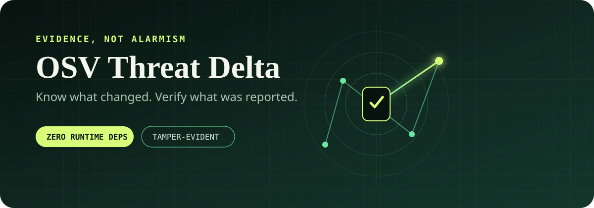

<p align="center">
  
</p>

<p align="center">
  <a href="https://github.com/regsaddler/osv-threat-delta/actions/workflows/ci.yml"></a>
  <a href="LICENSE"></a>
  
</p>

# Know what changed. Verify what was reported.

**OSV Threat Delta** is a small, dependency-free scanner for hash-pinned Python
lockfiles. It queries [OSV.dev](https://osv.dev/) for the exact versions you
ship, records the raw response, reports new/changed/resolved advisories, and can
reconstruct its own conclusion from retained evidence.

It is designed for quiet, recurring checks. No language model, API key, agent,
database, or automatic remediation path is involved.

## Why another OSV client?

Most scanners answer, “What advisories are present?” Threat Delta also asks:

- Did the dependency inventory change?
- Is this advisory new, changed, or resolved since the prior scan?
- Can the report be reproduced from the raw provider response?
- Did anything alter the report, predecessor, or lockfile afterward?
- Does the result accidentally claim more authority than it has?

That last boundary is deliberate: a matching advisory is **not** proof of
runtime reachability or exploitability, and a quiet scan is **not** proof that
the application is secure.

## What makes it different

| Property | Behavior |
| --- | --- |
| Exact inventory | Accepts only exact PyPI pins with SHA-256 hashes |
| Delta-first | Separates new, changed, and resolved findings |
| Evidence-preserving | Stores the bounded raw OSV response by content hash |
| Independently checked | `verify` rebuilds findings and deltas from source evidence |
| Fail-closed transport | Rejects proxies, redirects, non-public DNS answers, compression, and oversized responses |
| Private state | Uses atomic writes, owner-only permissions, symlink refusal, and a process lock |
| No action engine | Cannot install, upgrade, remove, quarantine, deploy, or claim security assurance |

## Quick start

OSV Threat Delta currently supports macOS and Linux with Python 3.10 or newer.

```bash
git clone https://github.com/regsaddler/osv-threat-delta.git
cd osv-threat-delta
python3 -m venv .venv
. .venv/bin/activate
python -m pip install --no-deps -e .
```

Generate a fully pinned lockfile with hashes. For example, with `pip-tools`:

```bash
python -m pip install pip-tools
pip-compile --generate-hashes --output-file requirements.lock requirements.in
```

Run a scan. State must live outside every Git worktree:

```bash
osv-threat-delta scan \
  --root . \
  --lock requirements.lock \
  --state-dir "$HOME/.local/state/osv-threat-delta/my-project" \
  --format summary
```

Then verify the result against the current lockfile and retained raw response:

```bash
osv-threat-delta verify \
  --root . \
  --lock requirements.lock \
  --state-dir "$HOME/.local/state/osv-threat-delta/my-project" \
  --format summary
```

Example summary:

```text
THREAT_DELTA: APPLICABLE_FINDINGS_REPORTED
packages=31 active_findings=1 malicious_packages=0
baseline=COMPARABLE new=1 changed=0 resolved=0 notify=true
authority=remediation_allowed=false installation_allowed=false quarantine_allowed=false deployment_allowed=false publication_allowed=false security_assurance_granted=false
boundary=OSV findings for the exact pinned lock at one observation time; not runtime exposure, vulnerability absence, exploitability, containment, or remediation authority
```

Use `--format json` for machine-readable output. Add `--fail-on-findings` to
`scan` when a CI job should return status `1` for active findings. Without that
flag, findings are reported but do not turn a scheduled observation into a
failed process.

## Exit codes

| Code | Meaning |
| --- | --- |
| `0` | Scan completed, or verification passed |
| `1` | Active findings with `--fail-on-findings`, or verification failed |
| `2` | Input, integrity, filesystem, DNS, network, or provider evidence unavailable |

## Automation

`examples/scan-and-verify.sh` performs the two-step scan and verification. It
is suitable for a systemd timer, launchd job, or cron entry after you set the
project root and external state directory.

The scanner intentionally does not send notifications. Let your scheduler,
CI system, or a small wrapper notify only when `delta.notify` is true or a scan
returns `2`. This keeps delivery policy separate from evidence collection.

## Supported input

Threat Delta intentionally parses a narrow, reviewable subset of
`pip-compile --generate-hashes` output. Every dependency must be an exact `==`
pin followed by one or more SHA-256 hashes. Comments and blank lines are
allowed. Extras, editable installs, URLs, ranges, markers, includes, options, and
unhashed pins are rejected.

See [`docs/ARCHITECTURE.md`](docs/ARCHITECTURE.md) for the full grammar and
trust boundaries.

## Security model

The project assumes the local OS and Python interpreter are trustworthy. It
does not claim to defend against a compromised host, certificate authority, or
OSV service. It also does not perform application reachability analysis.

Read [`docs/THREAT_MODEL.md`](docs/THREAT_MODEL.md) before using the output as a
release gate. Report vulnerabilities privately according to
[`SECURITY.md`](SECURITY.md).

## Development

```bash
python -m unittest discover -s tests -v
python -m compileall -q src tests
```

The unit suite is offline by default. Network behavior is exercised through
bounded fakes so ordinary development never depends on the live OSV service.

## Status

This is an alpha release. The report schema is versioned, but compatibility is
not yet promised across pre-1.0 releases. The current implementation supports
PyPI lockfiles on POSIX systems only.

## License

[MIT](LICENSE) © 2026 Reg Saddler.
